# Class Activity 1 — System Calls in Practice

- **Student Name:** NHEAN SONITA
- **Student ID:** e20231177
- **Date:** 2026-11-13

---

## Warm-Up: Hello System Call

Screenshot of running `hello_syscall.c` on Linux:

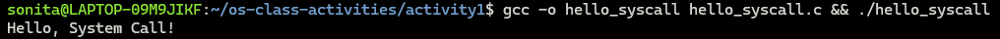

Screenshot of running `copyfilesyscall.c` on Linux:

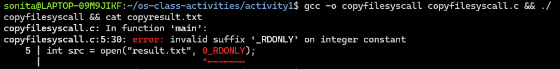

---

## Task 1: File Creator & Reader

### Part A — File Creator

**Describe your implementation:** The library version uses `fopen`/`fprintf`/`fclose`/`printf`. My version does the same job with `open`, `write`, `close`, and `write(1, ...)`. Both produce the same terminal output and the same `output.txt`. With system calls I choose the flags and permissions myself and handle lengths and errors manually. In strace, the library version created the file with mode `0666`, and mine with `0644`.

**Version A — Library Functions (`file_creator_lib.c`):**

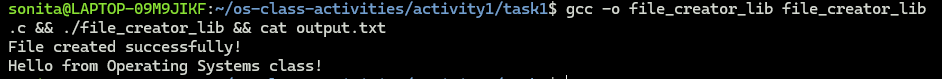

**Version B — POSIX System Calls (`file_creator_sys.c`):**

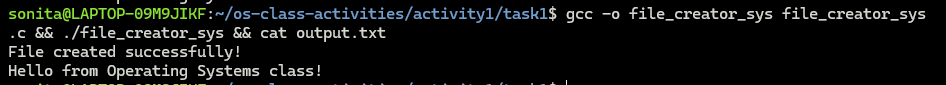

**Questions:**

1. **What flags did you pass to `open()`? What does each flag mean?**

   > I used `O_WRONLY | O_CREAT | O_TRUNC`. `O_WRONLY` opens the file for writing only. `O_CREAT` creates the file if it does not exist. `O_TRUNC` erases the old content if the file already exists.

2. **What is `0644`? What does each digit represent?**

   > It is the file permission in octal. The leading `0` marks octal. `6` = owner can read and write. `4` = group can read. `4` = others can read.

3. **What does `fopen("output.txt", "w")` do internally that you had to do manually?**

   > It calls `open()` with the right flags and a default mode, allocates a `FILE` structure with a memory buffer, and returns a pointer to it. Later, `fprintf` fills the buffer and `fclose` flushes it with `write()` and calls `close()`. With system calls I did each of these steps myself.

### Part B — File Reader & Display

**Describe your implementation:** My version opens `output.txt` with `open(O_RDONLY)`, reads it in a loop with `read()` into a 256-byte buffer, prints each chunk with `write(1, ...)`, and closes the file. The library version uses `fgets` and `printf`. The output is identical.

**Version A — Library Functions (`file_reader_lib.c`):**

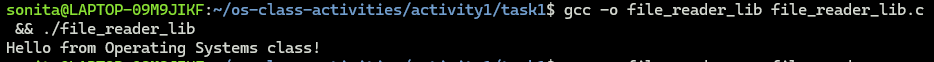

**Version B — POSIX System Calls (`file_reader_sys.c`):**

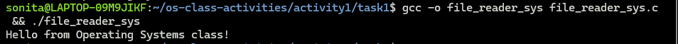

**Questions:**

1. **What does `read()` return? How is this different from `fgets()`?**

   > `read()` returns the number of bytes read, 0 at end of file, or -1 on error. It gives raw bytes and does not care about lines. `fgets()` reads one line as a string, adds a `\0` at the end, and returns NULL at the end of the file. It is buffered.

2. **Why do you need a loop when using `read()`? When does it stop?**

   > A single `read()` returns at most the buffer size (256 bytes), so a larger file needs several reads. The loop stops when `read()` returns 0, which means end of file.

---

## Task 2: Directory Listing & File Info

**Describe your implementation:** I kept `opendir`, `readdir`, and `stat`, and replaced every `printf` with `snprintf` into a buffer followed by `write(1, buffer, len)`. The output is the same as the library version.

### Version A — Library Functions (`dir_list_lib.c`)

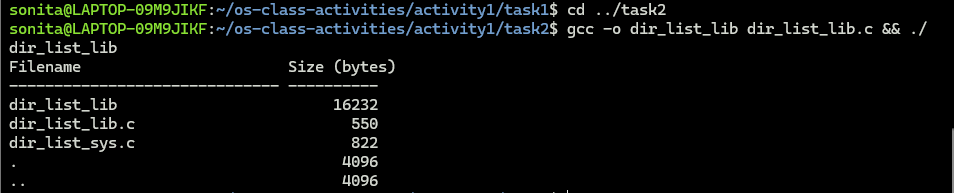

### Version B — System Calls (`dir_list_sys.c`)

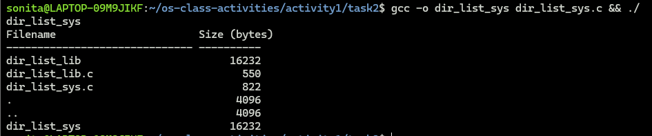

### Questions

1. **What struct does `readdir()` return? What fields does it contain?**

   > It returns a pointer to `struct dirent`. Its fields include `d_ino` (inode number), `d_off` (offset), `d_reclen` (record length), `d_type` (file type), and `d_name` (the file name).

2. **What information does `stat()` provide beyond file size?**

   > It also gives the file type and permissions (`st_mode`), owner and group (`st_uid`, `st_gid`), inode number, number of hard links, last access/modify/change times, and block size and block count.

3. **Why can't you `write()` a number directly — why do you need `snprintf()` first?**

   > `write()` only sends raw bytes from memory. A number like 1234 is stored in binary, so writing it would not show the characters "1234". `snprintf()` converts the number into a text string first.

---

## Task 3: strace Analysis

**Describe what you observed:** Both programs load `libc` at startup, so most system calls are the same. The library version made **38** system calls and the system call version made **34**. The library version had more `brk` calls (3 vs 1) and more `fstat` calls (4 vs 2). It also created the file with mode `0666` instead of `0644`.

### strace Output — Library Version (File Creator)

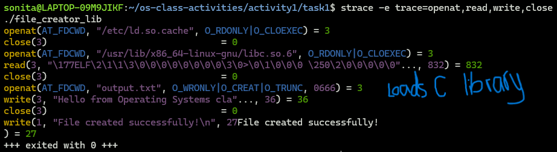

### strace Output — System Call Version (File Creator)

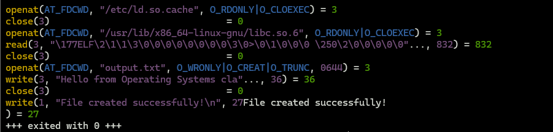

### strace Output — Library Version (File Reader)

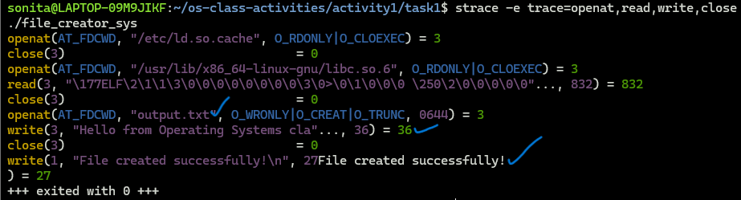

### strace Output — System Call Version (File Reader)

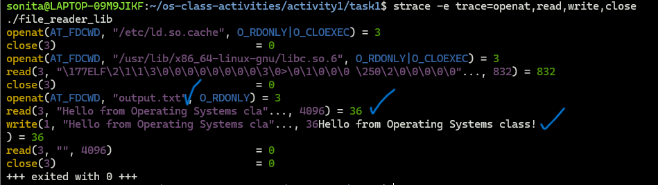

### strace -c Summary Comparison

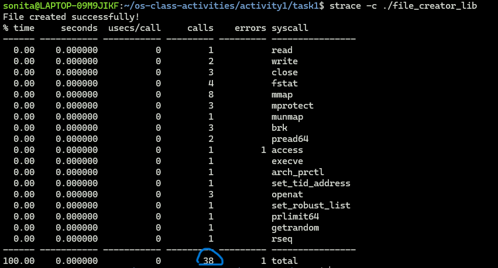
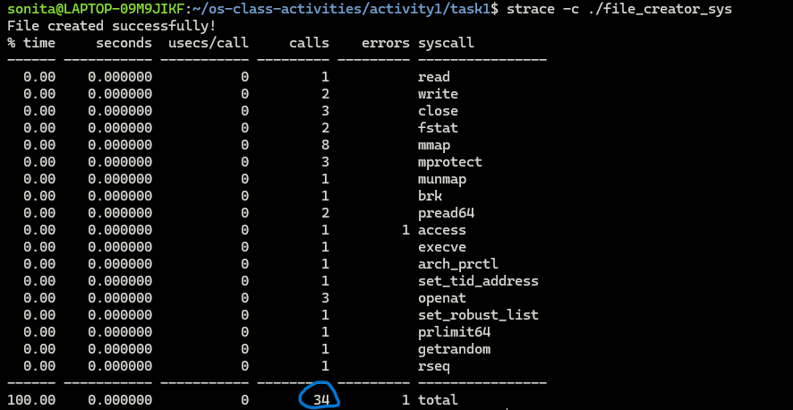

### Questions

1. **How many system calls does the library version make compared to the system call version?**

   > From `strace -c`, the library version made 38 system calls and the system call version made 34.

2. **What extra system calls appear in the library version? What do they do?**

   > The library version had 2 extra `brk` calls (3 vs 1) and 2 extra `fstat` calls (4 vs 2). `brk` grows the heap, which the library uses for the `FILE` buffer. `fstat` checks what kind of file the output is, so the library can choose a buffering mode. Both programs also have `execve`, `mmap`, `mprotect`, `access`, and the `openat` of `libc.so.6`, because any C program loads the C library.

3. **How many `write()` calls does `fprintf()` actually produce?**

   > One: `write(3, "Hello from Operating Systems cla"..., 36) = 36`. This matches what I expected, because `fprintf` stores the text in a buffer and `fclose` flushes it all at once.

4. **In your own words, what is the real difference between a library function and a system call?**

   > A library function is normal user-space code that can add buffering and formatting and then calls the kernel. A system call is the actual request to the kernel. Only the kernel can do privileged work such as opening files or writing to devices, so every library I/O function eventually ends in a system call.

---

## Task 4: Exploring OS Structure

### System Information

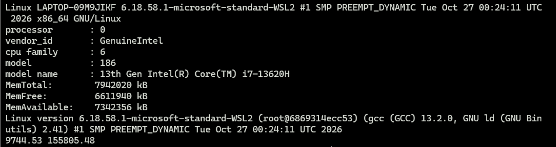

### Process Information

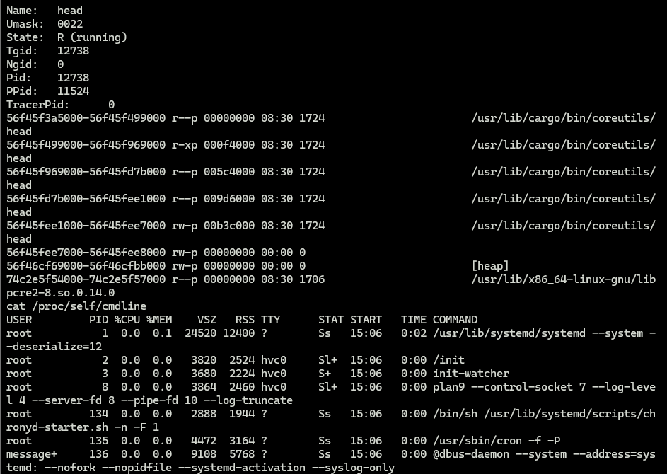

### Kernel Modules

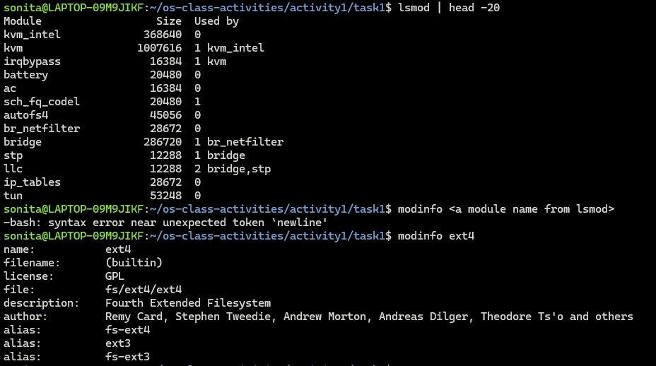

Note: WSL2 uses a Microsoft kernel where most features are built in. `modinfo ext4` shows `filename: (builtin)`, so `lsmod` lists few or no loadable modules.

### OS Layers Diagram

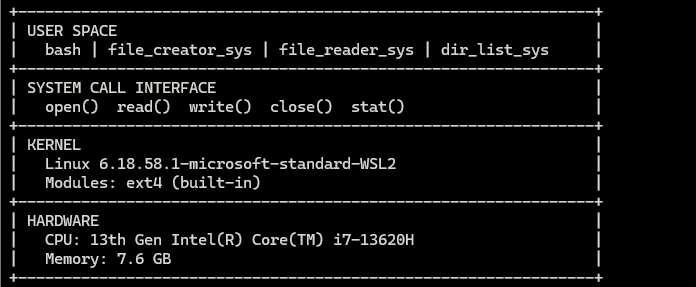

### Questions

1. **What is `/proc`? Is it a real filesystem on disk?**

   > `/proc` is a virtual filesystem. It is not stored on disk. The kernel generates its content on the fly when a file is read, so it shows the current state of the system (CPU, memory, processes).

2. **Monolithic kernel vs. microkernel — which type does Linux use?**

   > A monolithic kernel runs all major services (file systems, drivers, memory management) in kernel space. A microkernel keeps only the basics in the kernel and runs the rest in user space. Linux is monolithic: for example, ext4 is built into the kernel (`(builtin)`). Linux can also load modules at runtime, but they also run in kernel space.

3. **What memory regions do you see in `/proc/self/maps`?**

   > The program's code and data (the `cat` binary), the heap (`[heap]`), the stack (`[stack]`), shared libraries (`libc.so.6`, the dynamic loader `ld-linux`), and special kernel regions (`[vvar]`, `[vdso]`).

4. **Break down the kernel version string from `uname -a`.**

   > It shows the OS name (`Linux`), the machine name (`LAPTOP-09M9JIKF`), the kernel release (`6.18.58.1-microsoft-standard-WSL2`: version 6.18.58.1, built by Microsoft for WSL2), the build number and date, and the hardware architecture (`x86_64`).

5. **How does `/proc` show that the OS is an intermediary between programs and hardware?**

   > Programs never read the hardware directly. When I `cat /proc/cpuinfo` or `/proc/meminfo`, the kernel collects the CPU and memory information and gives it to my program through a normal file read. So the kernel sits between the program and the hardware.

---

## Reflection

I learned that library functions like `fopen` and `printf` are wrappers that end in system calls such as `openat` and `write`. The most surprising thing was that strace showed the library version and my system call version were almost the same, with only a few extra calls like `brk` and `fstat` for buffering, and that both load `libc` at startup.
