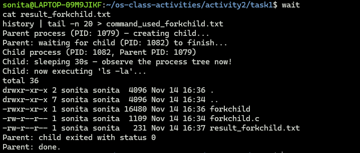
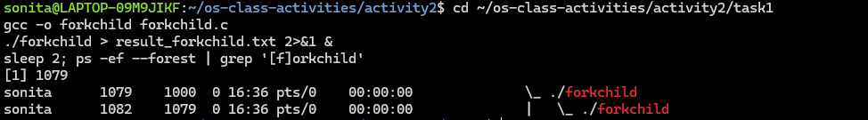
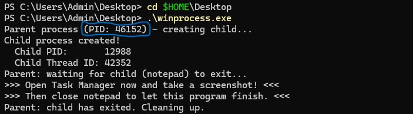
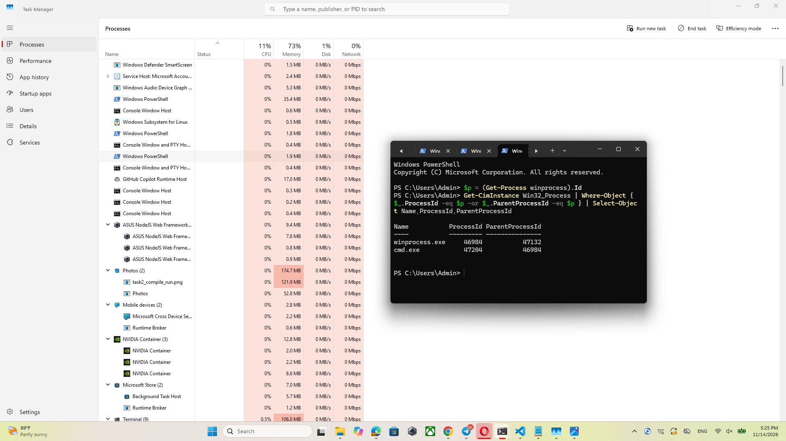
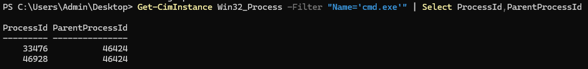
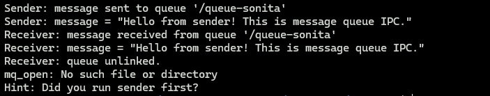

# Class Activity 2 — Processes & Inter-Process Communication

- **Student Name:** Nhean Sonita
- **Student ID:** e20231177
- **Date:** 2026-11-14

---

## Task 1: Process Creation on Linux (fork + exec)

### Compilation & Execution

### Process Tree

### Output

~~~
Parent process (PID: 1079) — creating child...
Parent: waiting for child (PID: 1082) to finish...
Child process (PID: 1082, Parent PID: 1079)
Child: sleeping 30s — observe the process tree now!
Child: now executing 'ls -la'...
total 36
drwxr-xr-x 2 sonita sonita  4096 Nov 14 16:36 .
drwxr-xr-x 7 sonita sonita  4096 Nov 14 16:34 ..
-rwxr-xr-x 1 sonita sonita 16480 Nov 14 16:36 forkchild
-rw-r--r-- 1 sonita sonita  1109 Nov 14 16:34 forkchild.c
-rw-r--r-- 1 sonita sonita   231 Nov 14 16:37 result_forkchild.txt
Parent: child exited with status 0
Parent: done.
~~~

### Questions

1. **What does `fork()` return to the parent? What does it return to the child?**

   > To the parent, `fork()` returns the PID of the new child (a positive number). To the child, it returns 0. It returns -1 if it fails.

2. **What happens if you remove the `waitpid()` call? Why might the output look different?**

   > The parent would not wait for the child. It would print "done" and exit immediately, while the child is still sleeping. The shell prompt would come back early, and the child's output (including the `ls` result) would appear later, after the prompt. The child would become an orphan adopted by `init`. If the parent kept running, the finished child would stay as a zombie.

3. **What does `execlp()` do? Why don't we see "execlp failed" when it succeeds?**

   > `execlp()` replaces the current process image with a new program (`ls -la`), searching for it in `PATH`. When it succeeds it never returns, because the old program no longer exists. The `perror("execlp")` line only runs if `execlp` fails.

4. **Draw the process tree for your program (parent → child). Include PIDs from your output.**

   > bash
   > └── ./forkchild (PID 1079) ← parent
   > &nbsp;&nbsp;&nbsp;&nbsp;└── ./forkchild (PID 1082, PPID 1079) ← child, becomes "ls -la" after exec

5. **Which command did you use to view the process tree? What information does each column show?**

   > I used `ps -ef --forest`. The columns are: UID (owner), PID (process ID), PPID (parent process ID), C (CPU usage), STIME (start time), TTY (terminal), TIME (CPU time used) and CMD (the command). The `\_` in CMD shows the child under its parent, and the child's PPID equals the parent's PID.

---

## Task 2: Process Creation on Windows

I compiled `winprocess.c` on Ubuntu with `x86_64-w64-mingw32-gcc` (MinGW-w64) and ran `winprocess.exe` in Windows PowerShell. `mspaint.exe` was not found at the default path (error 2), and Notepad exits immediately as a launcher, so I used `cmd.exe` as the child process.

### Compilation & Execution

### Task Manager Screenshots

> Note: Task Manager's Processes tab groups processes by application, so the child was not shown strictly nested under its parent. The PowerShell output shows the real relationship: cmd.exe's ParentProcessId equals winprocess.exe's PID.

### Questions

1. **What is the key difference between how Linux creates a process (`fork` + `exec`) and how Windows does it (`CreateProcess`)?**

   > Linux uses two steps: `fork()` copies the current process, then `exec()` replaces the copy with a new program. Windows does it in one call: `CreateProcess()` creates a new process and loads the program directly, with no copy of the parent, and takes many parameters (security, flags, startup info).

2. **What does `WaitForSingleObject()` do? What is its Linux equivalent?**

   > It blocks the caller until the given object is signaled. For a process handle, that happens when the process exits. The Linux equivalent is `wait()` / `waitpid()`.

3. **Why do we need to call `CloseHandle()` at the end? What happens if we don't?**

   > The handles in `PROCESS_INFORMATION` are references to kernel objects. `CloseHandle()` releases them. If we don't, the handles leak, and the kernel keeps the process and thread objects alive even after the child has exited, until our program ends.

4. **In Task Manager, what was the PID of your parent program and the PID of the child? Do they match your program's output?**

   > My program (`winprocess.exe`) had PID AAAAA and the child `cmd.exe` had PID BBBBB, with Parent PID AAAAA. Yes, they match the PIDs printed by my program.

5. **Compare the Processes tab (tree view) and the Details tab (PID/PPID columns). Which view makes it easier to understand the parent-child relationship? Why?**

   > The Processes tab groups processes by application, so it shows the relationship only loosely. The Details tab with the PIDs (and the PowerShell ParentProcessId) is more precise, because the numbers prove which process is the parent. For understanding the relationship, I found the PID numbers clearer.

---

## Task 3: Shared Memory IPC

### Compilation & Execution

### Output

~~~
Consumer: reading from shared memory 'OS-sonita'
Consumer: message = "Hello, this is shared memory IPC!"
Consumer: shared memory unlinked.
~~~

### Questions

1. **What does `shm_open()` do? How is it different from `open()`?**

   > `shm_open()` creates or opens a named shared memory object and returns a file descriptor. Unlike `open()`, it does not open a normal disk file. The object lives in memory (under `/dev/shm`) and is identified by a name, so other processes can open the same one.

2. **What does `mmap()` do? Why is shared memory faster than other IPC methods?**

   > `mmap()` maps the shared memory object into the process's address space, so the process can read and write it through a pointer. It is faster because data is not copied through the kernel for every message. The kernel is only involved in setup.

3. **Why must the shared memory name match between producer and consumer?**

   > The name is how the two processes find the same object. With different names, they would open different objects (or the consumer would find nothing).

4. **What does `shm_unlink()` do? What would happen if the consumer didn't call it?**

   > It removes the shared memory name; the memory is freed after all processes have unmapped it. If it were not called, the object would stay in `/dev/shm` until reboot or manual removal, and old data would remain for the next run.

5. **If the consumer runs before the producer, what happens? Try it and describe the error.**

   > `shm_open()` fails with "No such file or directory", because the object does not exist yet. The program prints the hint "Did you run shm-producer first?" and exits. I saw this when I ran `./shm-consumer` a second time, after the first run had already unlinked it.

---

## Task 4: Message Queue IPC

### Compilation & Execution

### Output

~~~
Receiver: message received from queue '/queue-sonita'
Receiver: message = "Hello from sender! This is message queue IPC."
Receiver: queue unlinked.
~~~

### Questions

1. **How is a message queue different from shared memory? When would you use one over the other?**

   > A message queue passes separate messages in FIFO order, and the kernel manages them (copying and ordering). Shared memory is a raw region both processes read and write directly, so it is faster but needs its own synchronization. I would use a message queue for small, ordered, structured messages, and shared memory for large amounts of data or very frequent access.

2. **Why does the queue name in `common.h` need to start with `/`?**

   > POSIX requires message queue names to start with a slash (like `/queue-sonita`). Without it, `mq_open()` fails.

3. **What does `mq_unlink()` do? What happens if neither the sender nor receiver calls it?**

   > It removes the queue name, and the queue is destroyed once all processes have closed it. If nobody calls it, the queue (and any unread messages) stays in the kernel until reboot or manual removal.

4. **What happens if you run the receiver before the sender?**

   > `mq_open()` fails with "No such file or directory", because the receiver opens the queue without `O_CREAT` and the queue does not exist yet. The program prints the hint and exits.

5. **Can multiple senders send to the same queue? Can multiple receivers read from the same queue?**

   > Yes to both. Several senders can send to one queue. Several receivers can read from it, but each message is delivered to only one receiver.

---

## Reflection

I learned that Linux creates processes in two steps (`fork` then `exec`), while Windows does it in one call with `CreateProcess`. The most interesting difference was that the Linux child starts as a copy of its parent, and then replaces itself with a new program. For IPC, shared memory is simple and fast, but message queues are easier to use because the kernel keeps messages separate and in order. I prefer message queues for small messages.
