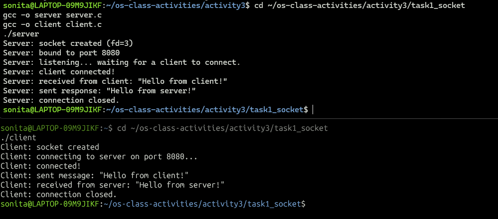
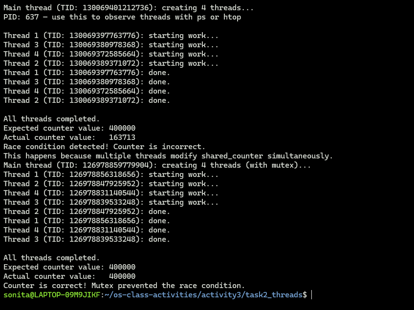
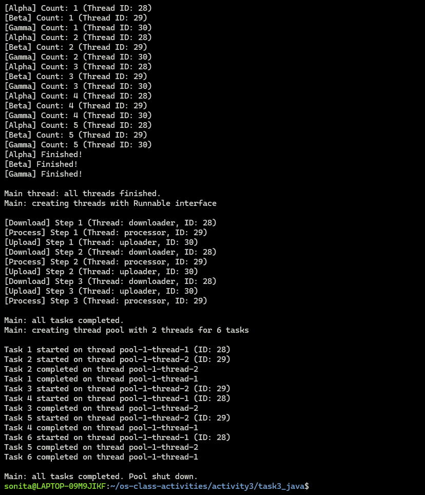
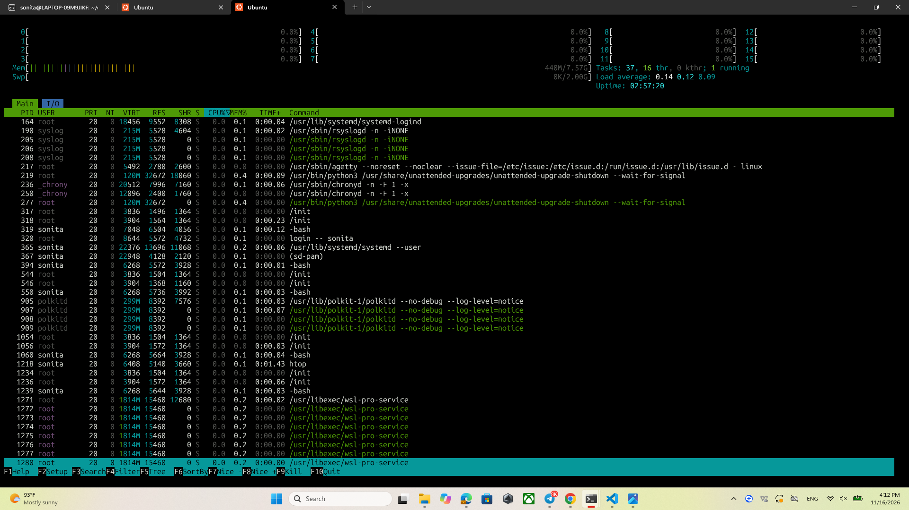
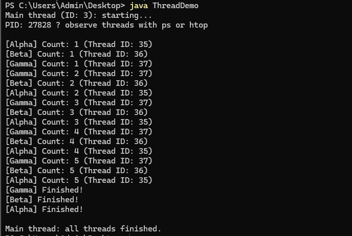
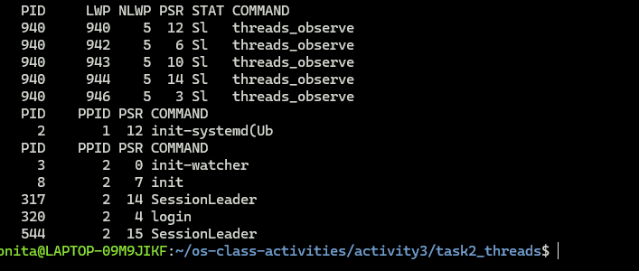

# Class Activity 3 — Threads

- **Student Name:** Nhean Sonita
- **Student ID:** e20231177
- **Date:** 2026-11-16

---

## Task 1: Socket Exchange

### Execution and Output

### Explanation

This task demonstrates communication between processes using sockets. The screenshot shows the socket exchange program and its output.

---

## Task 2: Threads Output

### Execution and Output

### Explanation

This task demonstrates how threads are created and executed. Multiple threads can run within the same process and share its resources.

---

## Task 3: Java Threads

### Execution and Output

### Explanation

This task demonstrates thread creation and execution in Java. Java supports multithreading, allowing multiple threads to perform tasks concurrently.

---

## Task 4: Thread Monitoring

### htop Threads

### htop Kernel Threads

### Task Manager Threads

### Kernel Threads

### Explanation

This task demonstrates how to monitor threads using different system tools.

- **htop:** Displays running processes and their threads in Linux.
- **Kernel Threads:** Shows threads managed by the Linux kernel.
- **Task Manager:** Displays thread information for processes in Windows.

---

## Reflection

Through this activity, I learned about socket communication, thread creation, Java multithreading, and thread monitoring. I also learned how to use htop and Task Manager to observe threads running in an operating system.

